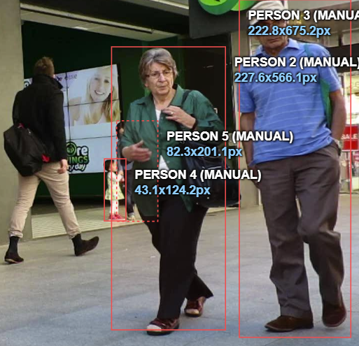
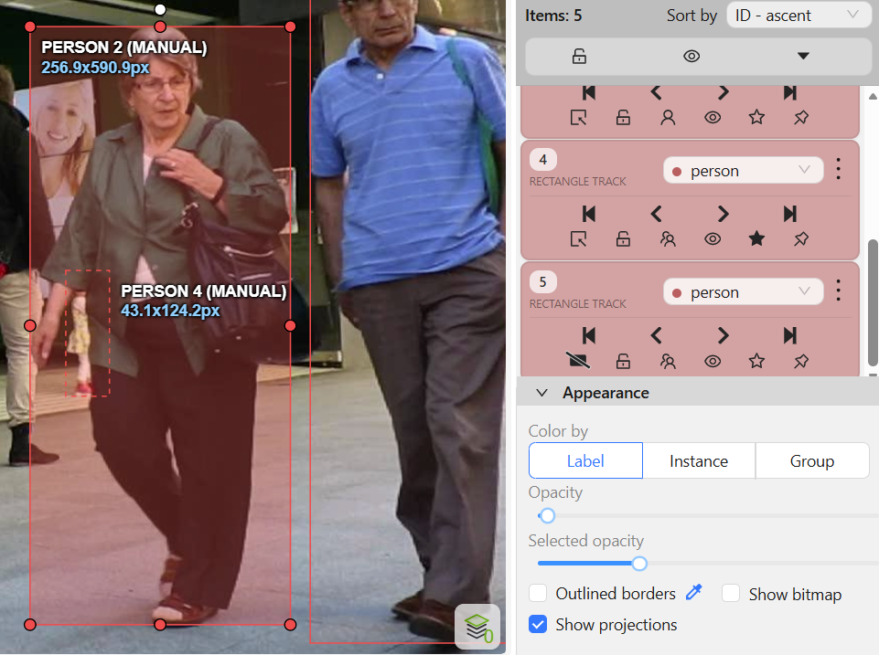
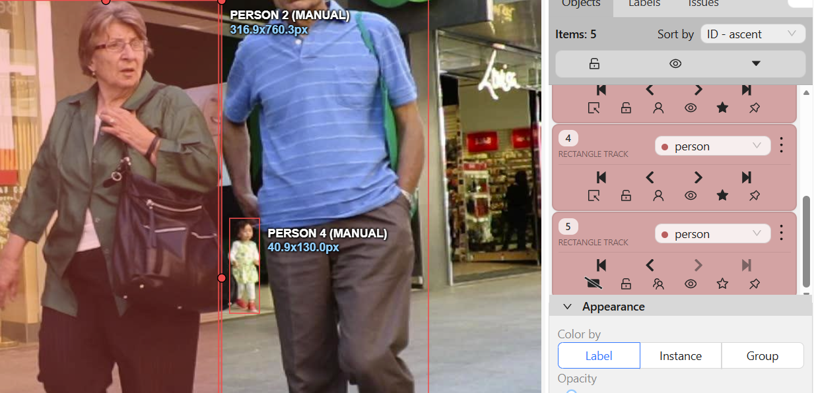

# Báo cáo cá nhân — Tạ Xuân Anh Vũ

**Đoạn video:** MOT17-09, 150 frame (frame 1–150), nguồn MOTChallenge, giấy phép CC BY-NC-SA 3.0.

## 0. Thông tin học viên

| Thông tin | Nội dung |
|---|---|
| Họ tên | Tạ Xuân Anh Vũ |
| MSSV | 2A202603173 |
| Mã đề (A/B/C) | B |
| Email | 26ai.vutxa@vinuni.edu.vn |
| Link repository | [GitHub Repository](https://github.com/AnhVuTaXuan/K5-L2-DAY05-TaXuanAnhVu-2A202603173-MOTTracking) |
| Giờ bắt đầu | 16h30 |
| Giờ kết thúc | 19h30 |

## 1. Xem trước đoạn video (CP0)

Ghi nhận trước khi vẽ, mỗi người một dòng.

| Mã | Frame xuất hiện | Frame cuối thấy được | Rẽ / dừng / đổi tốc độ ở frame | Bị che ở frame | Ghi chú |
|---|---:|---:|---|---|---|
| P1 | 0 | 150 | — | 39–49 | |
| P2 | 0 | 150 | — | Không bị | |
| P3 | 40 | 150 | — | 0–40 | |
| P4 | 0 | 146 | — | 111–135, 147–150 | |
| P5 | 2 | 105 | — | 105 | |

## 2. Keyframe và thời gian (CP1, CP4)

Số keyframe lấy từ kết quả `src/check_submission.py`.

| Mã | Số keyframe | Keyframe ở frame | Số frame có mặt | Keyframe / 100 frame | Thời gian (phút) | Chỗ khó |
|---|---:|---|---:|---:|---|---|
| P1 | 66 | 0, 6, 7, 10–20, 23, 25–26, 28–34, 37, 49–54, 56–59, 65, 67, 69–70, 72–76, 79–85, 89–90, 96, 99, 109, 111–115, 119, 124, 129, 139, 149 | 140 | 47.1 | Chưa ghi nhận | 53 frame occluded, 1 lần bật outside |
| P2 | 32 | 0, 10, 20, 27, 30, 40, 50, 60, 62, 64, 70, 80, 88, 90, 100, 102, 104, 110, 114–116, 120, 122–123, 125–128, 130, 135, 140, 149 | 150 | 21.3 | Chưa ghi nhận | Theo dõi xuyên suốt video, cần duy trì ID ổn định |
| P3 | 19 | 0, 9–10, 19–20, 30, 40, 50, 59, 69, 79, 89, 99, 109, 136–140 | 122 | 15.6 | Chưa ghi nhận | 6 frame occluded, 2 lần bật outside |
| P4 | 9 | 2, 12, 22, 32, 42, 52, 72, 82, 92 | 103 | 8.7 | Chưa ghi nhận | Theo dõi từ frame 2 đến 104 |
| P5 | 20 | 40, 48–49, 59, 69, 79, 88–90, 96, 100, 110, 115, 120, 130, 132, 135, 139–140, 149 | 110 | 18.2 | Chưa ghi nhận | Xuất hiện từ frame 40, cần theo dõi khi xuất hiện |

### Tổng hợp

| Tổng số keyframe | Tổng số frame có mặt | Keyframe / 100 frame |
|---:|---:|---:|
| **146** | **625** | **23.4** |

**Công thức tính:**

```text
Keyframe / 100 frame
= Tổng keyframe / Tổng số frame có mặt × 100
= 146 / 625 × 100
= 23.4 keyframe / 100 frame
```

### Bạn đặt keyframe nhiều nhất ở người nào? Vì sao?

Tôi đặt keyframe nhiều nhất ở P1 với 66 keyframe, tương đương 47.1 keyframe / 100 frame. Đây là đối tượng có độ khó theo dõi cao nhất, với 53 frame bị occluded và 1 lần bật outside. Vì vậy, tôi cần đặt nhiều keyframe hơn để kiểm soát vị trí bounding box, duy trì độ chính xác khi đối tượng bị che khuất và xuất hiện trở lại.

> Quy ước frame: Số frame hiển thị trên CVAT bắt đầu từ 0. Trong `gt.txt`, `frame_id = frame CVAT + 1`.

## 3. Đoạn bị che (CP2)

**Người bị che: P4**

| Mốc | Frame |
|---|---:|
| Bắt đầu bị che một phần (bật `occluded`) | 105 |
| Mất hẳn (bật `outside`) | 111 |
| Hiện lại (tắt `outside`) | 136 |
| Thấy rõ trở lại (tắt `occluded`) | 140 |

### 3.1. Thời gian bị khuất hẳn

Cô bé bị khuất trong **2 khoảng riêng biệt**:

| Lần | Khoảng frame | Số frame |
|---|---|---:|
| Lần 1 | 111–135 | 25 |
| Lần 2 | 147–150 | 4 |
| **Tổng** | **Hai khoảng riêng biệt** | **29** |

**Cách tính:** Tính cả frame bắt đầu và frame kết thúc. Ví dụ:

`135 - 111 + 1 = 25 frame`.

- Lần 1: **25 frame**.
- Lần 2: **4 frame**.
- Tổng thời gian khuất hẳn: **29 frame**.

Nếu video có tốc độ 30 FPS:

- Lần 1: `25 / 30 ≈ 0.83 giây`.
- Lần 2: `4 / 30 ≈ 0.13 giây`.
- Tổng: `29 / 30 ≈ 0.97 giây`.

> Nếu video không chạy ở 30 FPS, hãy lấy số frame chia cho FPS thực tế để tính số giây.

### 3.2. Quyết định

**Đề xuất: Giữ cùng ID P4**, với điều kiện khi cô bé xuất hiện lại, ngoại hình và diễn biến vị trí phù hợp với người trước khi bị che.

### 3.3. Lý do

1. Lần khuất thứ nhất kéo dài 25 frame và lần thứ hai kéo dài 4 frame; cả hai khoảng đều ngắn hơn ngưỡng 60 frame.
2. Cần đối chiếu trang phục, vóc dáng và các đặc điểm nhận dạng trước và sau mỗi lần khuất để xác nhận ngoại hình vẫn khớp.
3. Vị trí xuất hiện lại cần phù hợp với hướng di chuyển và tốc độ trước khi bị khuất; nếu không có dấu hiệu mâu thuẫn thì có thể tiếp tục giữ ID P4.

### 3.4. Ảnh chụp màn hình

**Trước khi che**



**Giữa đoạn che, thấy cờ trên panel object**



**Sau khi hiện lại, cùng ID**



## 4. Tự review ID (CP3)

Lượt 1 theo người (đi ngược từ frame 149 về 0 trên CVAT), lượt 2 theo cảnh (nhảy 10 frame).

Các mã lỗi sử dụng theo quy định: `id_switch`, `fragmentation`, `lost`, `merge`, `false_track`, `drift`, `flag`.

| Frame | Mã người | Loại lỗi | Mô tả một câu | Phát hiện ở lượt | Đã sửa? |
|---:|---|---|---|---|---|
| 146 | P4 | `flag` | Người vẫn có thể nhìn thấy và dự đoán khung | Lượt 1 | Đã sửa |
| 53 | P1 | `drift` | Khung bị thu hẹp quá khiến không bao quát được tay P1 lúc giơ ra | Lượt 1 | Đã sửa |
| 51 | P1 | `flag` | Người vẫn có thể nhìn thấy và dự đoán khung | Lượt 1 | Đã sửa |

### Tổng hợp số lỗi theo loại

| `id_switch` | `fragmentation` | `lost` | `merge` | `false_track` | `drift` | `flag` |
|---:|---:|---:|---:|---:|---:|---:|
| 0 | 0 | 0 | 0 | 0 | 1 | 2 |

### Lỗi nào chỉ lượt 2 (theo cảnh) mới thấy, lượt 1 (theo người) không thấy? Vì sao?

Lượt 2 không phát hiện thêm lỗi mới; các lỗi đã ghi nhận đều được phát hiện ở lượt 1.

## 5. File xuất và kết quả tự kiểm (CP4)

| Kiểm tra | Kết quả |
|---|---|
| Tên file MOT 1.1 | `TaXuanAnhVu_mot.zip` |
| Tên file CVAT for video 1.1 | `TaXuanAnhVu_cvat_video.zip` |
| Số track ID khác nhau trong `gt/gt.txt` (phải là 5) | 5 |
| Frame `outside` không có dòng trong `gt.txt` | Đúng |
| Job đã completed trên CVAT máy cá nhân | Đúng |

### Kết quả `src/check_submission.py`

```text
=== Tóm tắt ===
Lỗi: 0 | Cảnh báo: 0
Đạt. Dán phần tóm tắt này vào báo cáo mục 5.
```

## 6. Ba câu kết

### 6.1. Nếu được gán lại, bạn sẽ đặt keyframe khác ở đâu? Vì sao?

Nếu được gán lại, tôi sẽ bổ sung hoặc điều chỉnh keyframe tại frame 51 và 53 của P1 để thể hiện chính xác trạng thái và phạm vi bbox khi người vẫn còn nhìn thấy, đặc biệt là phần tay giơ ra ở frame 53. Với P4, tôi sẽ kiểm tra kỹ các keyframe tại frame 111, 136, 140 và 146 để bảo đảm trạng thái occluded và outside phản ánh đúng khả năng quan sát người trong từng thời điểm.

### 6.2. Có chỗ nào bạn không chắc "cùng ID hay ID mới"? Bạn đã quyết định và ghi chú thế nào?

Tôi chưa chắc chắn nhất ở đoạn P4 xuất hiện lại tại frame 136 sau khi bị khuất hoàn toàn từ frame 111 đến 135. Tôi quyết định giữ ID P4 nếu ngoại hình, vị trí xuất hiện lại và hướng di chuyển phù hợp với diễn biến trước khi bị khuất. Tôi ghi chú đoạn này để ưu tiên kiểm tra lại tính liên tục của danh tính và trạng thái tracking.

### 6.3. Một lỗi ID trong job của bạn có thể làm xe tự lái dự đoán sai chuyển động của người đó như thế nào? Lỗi đó ảnh hưởng MOTA hay IDF1 nhiều hơn?

Trong job của tôi, lỗi drift tại frame 53 của P1 khiến bbox không bao quát hết phần tay đang giơ ra, làm sai lệch vị trí và kích thước thực tế của người trong dữ liệu tracking. Nếu lỗi này xuất hiện trong hệ thống xe tự lái, mô hình có thể ước lượng chưa chính xác phạm vi chiếm chỗ của người đi bộ, từ đó ảnh hưởng đến việc đánh giá khoảng cách an toàn và dự đoán chuyển động.

Lỗi định vị bbox thường tác động trực tiếp đến MOTA thông qua các trường hợp không khớp IoU, dẫn đến false positive hoặc false negative. Tuy nhiên, nếu bbox sai lệch đủ lớn khiến đối tượng không được ghép nối chính xác, IDF1 cũng có thể bị ảnh hưởng. Vì vậy, mức độ ảnh hưởng cụ thể phụ thuộc vào mức độ sai lệch của bbox và kết quả matching.

### Bonus (nếu làm)

#### B1 — Hai người đi sát

...

#### B2 — So cách đặt keyframe

| Cách đặt | Số keyframe | Frame trôi nhất | Ghi chú |
|---|---:|---|---|
| Đều mỗi 30 frame | | | |
| Theo chỗ đổi hướng | | | |

...

#### B3 — So với tracker có sẵn

| Frame | Mã người | Tracker làm gì | Nhãn của bạn | Giải thích (đoán rồi sửa / ghép IoU / box score thấp / ngoại hình) |
|---:|---|---|---|---|
| | | | | |
| | | | | |

...

## 7. Tài liệu tham khảo và công cụ AI đã dùng


- Công cụ AI: ChatGPTgit.
